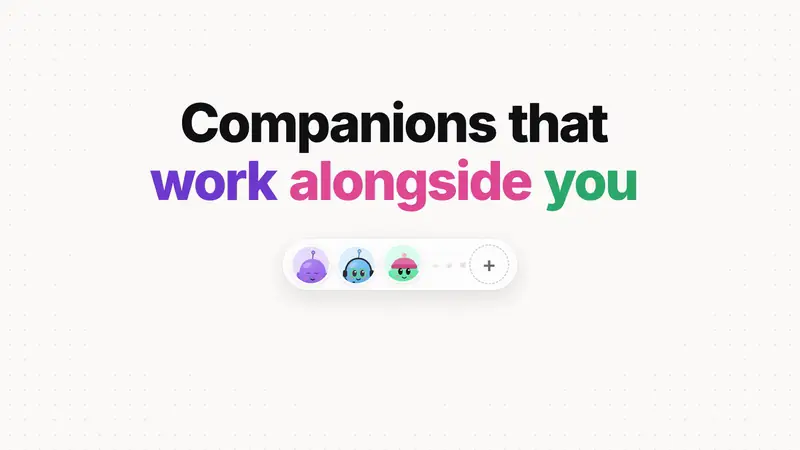
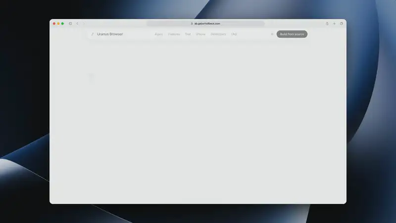
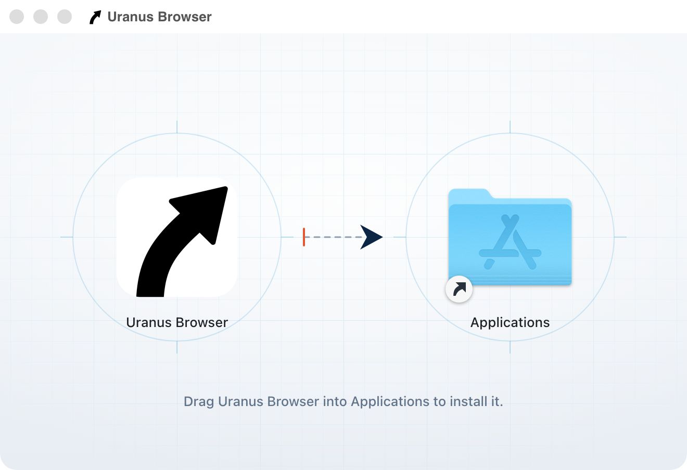
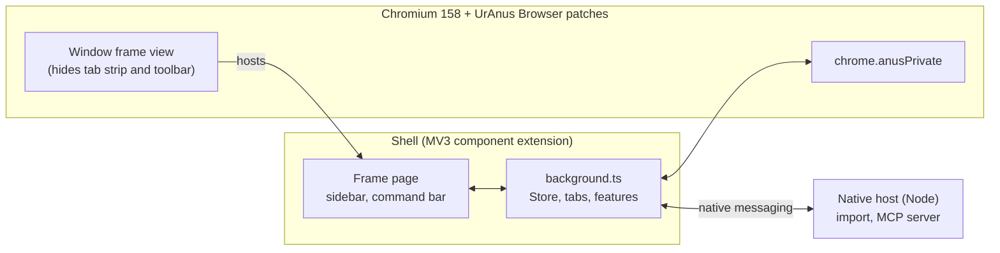

# UrAnus Browser

An Arc-style browser for developers, built on a Chromium fork. Arc's interface ideas are rebuilt from scratch; no Arc code is used.

**Docs:** [User guide](docs/user-guide.md) · [Privacy and data flows](docs/privacy.md) · [iPhone build](mobile/app/README.md)

The [product website](https://uranus-browser.gaborhollbeck.com/) has interactive demos.

> **Disclaimer:** UrAnus Browser is early release software provided “as is,” without warranty, under the [MIT License](LICENSE). Back up important data. Cloud AI can send page or meeting content to a provider; get everyone’s permission before recording. See [the full safety notice](#before-you-use-uranus-browser).

## Launch videos

The previews play silently. Click one to watch the full video.

### UrAnus Browser for Mac

[](https://uranus-browser.gaborhollbeck.com/launch-videos.html#desktop)

### UrAnus Browser for Mac · animated promo

[](docs/videos/uranus-browser-desktop-promo.mp4)

Companions, the agent's approvals, meeting notes, Algorithm Diet and Arc import, as motion graphics. People, messages and numbers are examples.

### Website hero tour

[](docs/videos/uranus-browser-website-hero.mp4)

A recording of the website's hero demos: Meet joins, Flight agent, Sidebar and Dark mode. It has no sound. The meeting and the flight are illustrative.

### UrAnus Browser for iPhone

[](https://uranus-browser.gaborhollbeck.com/launch-videos.html#iphone)

## Why

Arc's vertical sidebar, Spaces and Peek are hard to give up, and Arc is no longer where the work is happening. UrAnus Browser is a replacement that keeps those ideas and adds tools for the people who build websites.

It is a Chromium 158 fork rather than an Electron app because Google blocks sign-in in Electron. UrAnus Browser is real Chromium, so Google sign-in, Chrome Web Store extensions and the rest of the web platform work as they do in Chrome.

## Features

**Sidebar and tabs**
- A vertical sidebar with favourites, pinned tabs (with folders) and Today tabs, per Space
- Drag tabs between favourites, pinned, folders and Today
- Today tabs archive themselves after 12 hours by default (1 day, 7 days, 30 days or never in Settings); the archive is searchable
- Closing a pinned tab or favourite only unloads it and sends it back to its pinned URL
- Per-site favicons, tab muting, duplicate, copy link or Markdown link, copy screenshot
- On launch, the window comes back where it was

**Spaces**
- Spaces with their own colour and emoji; in dark mode the colour becomes a deep tint of the same hue
- Right-click a Space, then Separate Cookies and Logins, to be signed in as different users side by side (a persistent storage partition per Space)
- Switch with ⌃1 to ⌃9, or next and previous Space with ⌥⌘← and ⌥⌘→

**Command bar**

- On macOS, swipe to go back or forward; the previous page slides away.
- ⌘T for a new tab, ⌘L for the current one; it searches open tabs, the archive and history
- Developer shortcuts: `gh owner/repo`, `gh 123` (in the current tab's repo), `npm react`, `mdn grid`, `caniuse :has`, `so ...`, and `env`
- Paste a JWT or a Unix timestamp to decode it in place
- Type `boost` to open the Boosts page

**Peek, split view and UrAnus Mini**
- Peek: links that open a new tab from a pinned tab or favourite show in a floating preview; any link's right-click menu offers it too. Esc or a click outside closes it, Open turns it into a tab
- Split view: right-click a tab, Open in Split View, or ⌃⇧= to split with a new tab (⌃⇧- exits)
- UrAnus Mini: a small standalone window for a quick page (⌥⌘N), which can be sent back into the main window

**Boosts**
- Per-site TypeScript and CSS (`github.com.ts`, `github.com.css`, `all.css`), kept in UrAnus Browser and edited on the Boosts page. CSS applies live; scripts reload the page. ⌥⌘B edits the current site's boost

**For developers**
- Console error badge: local tabs show how many console errors they have; clicking it opens the Console
- Responsive view (⌥⌘M): the page as a phone (393px, touch, mobile user agent) next to desktop
- Running locally: dev servers listening on this Mac show up in the sidebar, named after their project folder
- Environments: group a project's origins (local, staging, production) in Settings; ⌥⌘E moves the page to the next one with the same path, and the address bar shows a LOCAL, STAGING or PROD badge
- Chromium's DevTools (⌥⌘I), View source (⌥⌘U), zoom and Find in page
- Agent panel (⌥⌘A, or the button next to the sidebar toggle): a chat beside the page, docked right or, by dragging its handle, left. The agent reads the current page, scrolls, clicks, types, navigates and switches tabs, and shows each step; anything that submits, sends, buys, signs in, changes an account, uploads, downloads or types a secret waits for your approval in the panel. Stop and Take over end it at any time. It runs on your ChatGPT plan (signed in through Codex) or an OpenAI API key, picked in Settings › AI (see [Agent panel](#agent-panel))
- Coding agents (MCP): Settings, Coding agents turns on a local MCP server (127.0.0.1, token required) so Claude Code, Cursor and others can list tabs, read pages and console logs, take screenshots, click, type and run JavaScript. It needs the native host (see Build from source)

**Privacy and the rest of the browser**

- Built-in ad and tracker blocking (EasyList and EasyPrivacy as declarativeNetRequest rules, plus element hiding), toggled in Settings
- Incognito windows get the same UrAnus Browser frame, with one in-memory Space that is forgotten when the last incognito window closes
- Import bookmarks and history from other browsers and from Arc's sidebar (needs the native host)
- Chrome extensions: install from the Chrome Web Store; their buttons appear under the address bar
- Light, dark or system theme; UrAnus Browser's shortcuts can be re-recorded in Settings (except a few Chromium keeps, like ⌘T and ⌘W) (⌘/ lists them)
- Settings (⌘,): importing from other browsers, search engine (Google, DuckDuckGo, Bing, Brave, Kagi, Ecosia), ad blocking, default browser, Peek behaviour, shortcuts, environments

Not there yet in the Chromium build: choosing the downloads folder from Settings.

## Before you use UrAnus Browser

UrAnus Browser is early release software, provided “as is” under the [MIT License](LICENSE). Bugs or security flaws can expose data or cause data loss. Keep a backup of important browser data and keep your existing browser and profile until you’ve checked the import.

- **Browser agent:** It can read pages and act in signed-in tabs. Keep it away from sensitive accounts and pages, and check what it is about to do before approving an action.
- **Cloud AI:** When you use a cloud provider, the feature can send prompts, page content, parts of files, or meeting audio and transcripts to that provider. Use on-device options where available for sensitive material. See [AI providers](docs/ai-providers.md) and [what leaves your Mac](docs/user-guide.md#where-your-data-lives).
- **Meeting recording:** Get permission from everyone before recording or inviting a bot that listens. Make sure your workplace permits it.

You can reread this notice in **Settings → Privacy**. See [Privacy and data flows](docs/privacy.md) and [Third-party notices](THIRD_PARTY_NOTICES.md) for more detail. The MIT notice does not limit rights that cannot be waived under applicable law.

## Install

1. [Download UrAnus Browser for Mac](https://uranus-browser.gaborhollbeck.com/download/macos/arm64) (Apple silicon).
2. Open the disk image and drag UrAnus Browser into Applications.

<p align="center"></p>

This repository distributes source. See [Build from source](#build-from-source) for a local macOS build,
or the [iPhone guide](mobile/app/README.md) for a simulator build.

The native messaging host handles browser imports and the optional local MCP server. The release
packaging script bundles it; Chromium registers it in the running profile.

## Agent panel

The Agent panel, routines and meeting notes run on whichever provider Settings › AI picks for each: your **ChatGPT plan** (Sign in with ChatGPT, through the official Codex app-server), an **OpenAI API key** (kept in the macOS Keychain), or, for meeting notes only, the on-device **Underdog** model. The composer's selector picks the chat's model (Model ›) and how hard it thinks (Thinking ›); a new model starts a fresh conversation. Details, limits and the security model: [docs/ai-providers.md](docs/ai-providers.md).

The key can also be stored from a terminal:

```bash
chromium/scripts/set-openai-key.sh                 # paste the key (hidden)
chromium/scripts/set-openai-key.sh --status        # or --delete
```

How a request flows: the panel page (`shell/ui/agent.ts`) sends your message to the shell's background, which passes it to the native host over native messaging. The host (`native-host/agentChat.ts`) asks the model for the next step; for each tool call it has the shell inspect the target, applies the rules in `shared/browserAgent.ts` (run, ask you, or refuse), shows an approval card when needed, and only then has the shell act. The shell reads pages in Chromium's isolated world and clicks and types with real input events; it refuses to act if the page changed since you approved. Page text goes to the model marked as untrusted data, and the panel shows only a short log of each step. The agent has no JavaScript tool.

Tests: `npm test` (tool schemas, approval rules, the chat loop, key isolation, panel layout, the AI registry, and the ChatGPT provider against a fake Codex app-server), and against a running build `node chromium/tests/e2e.mjs --app <UrAnus Browser.app>` (the agent on a local test page, with your key) and `node chromium/tests/e2e-layout.mjs --app <UrAnus Browser.app>` (docking, resizing and persistence).

For companions and memory, artifacts, routines, meeting notes, the agent joining meetings and the permissions step, see the [Agent panel user guide](docs/user-guide.md) (and the [feature log](docs/CHANGELOG-features.md)).

## Build from source

You need:

- macOS on Apple Silicon, with Xcode (and its command line tools)
- [depot_tools](https://commondatastorage.googleapis.com/chrome-infra-docs/flat/depot_tools/docs/html/depot_tools_tutorial.html) on your `PATH`
- a Chromium checkout at the version UrAnus Browser targets (158), with plenty of disk (100 GB or more) and several hours for a first build
- Node 24 and `npm ci` at the repo root
- `librsvg` (`brew install librsvg`) to generate macOS branding resources

Fetching the Chromium checkout isn't scripted here; follow Chromium's [macOS build instructions](https://chromium.googlesource.com/chromium/src/+/main/docs/mac_build_instructions.md). Use a dedicated APFS checkout at the tag in [chromium/CHROMIUM_VERSION](chromium/CHROMIUM_VERSION). Applying patches resets the Chromium files it changes.

Set `CHROMIUM_SRC` to the checkout's `src` directory if it is not at `$HOME/chromium/src`.
Put depot_tools on `PATH` or set `DEPOT_TOOLS`. The development profile and dependency cache
default to `${XDG_CACHE_HOME:-$HOME/.cache}/anus-browser`; override with `ANUS_DISK` or
`ANUS_PROFILE`. There is no volume mounting step.

### The dev loop

```bash
npm ci
npm run shell:build
chromium/scripts/build.sh              # apply branding and patches, then build into out/Dev
chromium/scripts/run.sh                # launch the dev app with its own profile
```

`apply.sh` is safe to run again: it first resets every file it touches. The dev build is a component build, so a change relinks one small library. `run.sh` loads the shell from `chromium/shell/dist` through `--anus-shell-dir`, so UI work needs no Chromium build at all (`npm run shell:watch` rebuilds on save).

For imports or AI in a dev build, register the helper only in your dev profile:

```bash
export ANUS_PROFILE="${XDG_CACHE_HOME:-$HOME/.cache}/anus-browser/profiles/dev"
ANUS_HOST_DIR="$ANUS_PROFILE/native-host" chromium/scripts/install-native-host.sh --only "$ANUS_PROFILE"
```

### Build a local app

```bash
chromium/scripts/build-release.sh
```

The script builds Chromium and packages an ad hoc signed app under the Chromium checkout's
`out/Release/anus-release/` (use `ANUS_ARCH=x64` for Intel). This takes several hours on a fresh
checkout. Sparkle updates are off by default. Running the packaged app uses the standard
UrAnus Browser profile unless you pass Chromium's `--user-data-dir` with a separate directory.
See [release configuration](docs/release-configuration.md) if you maintain your own distribution.

To check the TypeScript without Chromium, run `npm run typecheck`, `npm test`,
`npm run shell:build` and `npm run host:build`. To check patch applicability without
a Chromium checkout, run `chromium/scripts/check-patches.sh`.

## Repo layout

```
chromium/
  patches/       the native changes to Chromium, as numbered unified diffs
  branding/      app icon, logo (SVG masters + build-logo.sh), BRANDING, the dmg background
  build/         dev.gn and release.gn (the GN args)
  scripts/       apply, build, run, env, build-release, package-release,
                 install-native-host, dmg-layout.py
  shell/         the MV3 component extension that draws the window
    background.ts   service worker: the Store, tabs, windows
    features/       ad blocking, boosts, console errors, local servers, responsive view
    ui/             sidebar, command bar, settings and UrAnus Mini pages
    lib/            URLs, shortcuts, environments, settings rules, tab manager
  shared/        types and the sidebar model, used by the shell and the host
  native-host/   the native messaging host (Node): imports, MCP, the Agent panel's model provider
  tests/         unit tests (npm test) and end-to-end tests against a running build
```

## Architecture in brief

UrAnus Browser is Chromium plus two layers: a small set of patches, and an extension that draws the browser.



- **Patches** (`chromium/patches/`) change what only Chromium can: hide the tab strip and toolbar, draw UrAnus Browser's own window frame and traffic lights, round the page area, add Peek, UrAnus Mini windows, split ratio, a storage partition per Space, and so on.
- **The shell** is a Manifest V3 extension loaded as a component extension, so it can't be removed or turned off. Its service worker (`background.ts`) owns the Store and the tabs; everything the user sees is shell HTML and TypeScript.
- **The frame page** is a shell page that Chromium's frame view hosts around the web contents. It draws the sidebar and command bar, and its drag regions move the window.
- **`chrome.anusPrivate`** (`shell/anusPrivate.d.ts`) is the private extension API the patches add, for what the standard APIs lack: frame state, shortcuts, theme, split ratio, Peek, UrAnus Mini, partitions, DevTools, the find bar and default-browser. It is available to the shell only.
- **The native host** does what an extension can't: read other browsers' bookmarks and history, and serve MCP to coding agents on 127.0.0.1.

## Status and roadmap

UrAnus Browser is early software, used daily by its author. Next:

- Resizable split divider and 3 to 4 pane splits
- Choosing the downloads folder in the Chromium build

## Contributing

Bug reports and patches are welcome; see [CONTRIBUTING.md](CONTRIBUTING.md) for setup, how patches work, and the commit style.

## License

The project code is under the [MIT license](LICENSE), with the original [Flecha Browser](https://github.com/lucianodiisouza/flecha-browser) notice preserved. Chromium and other components retain their own licenses; see [third-party notices](THIRD_PARTY_NOTICES.md). UrAnus Browser is not affiliated with or endorsed by Google, Arc or The Browser Company.

## Marketing site

The [static product demo](website/README.md) uses original illustrations and synthetic data.
